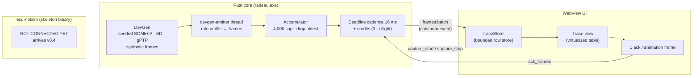
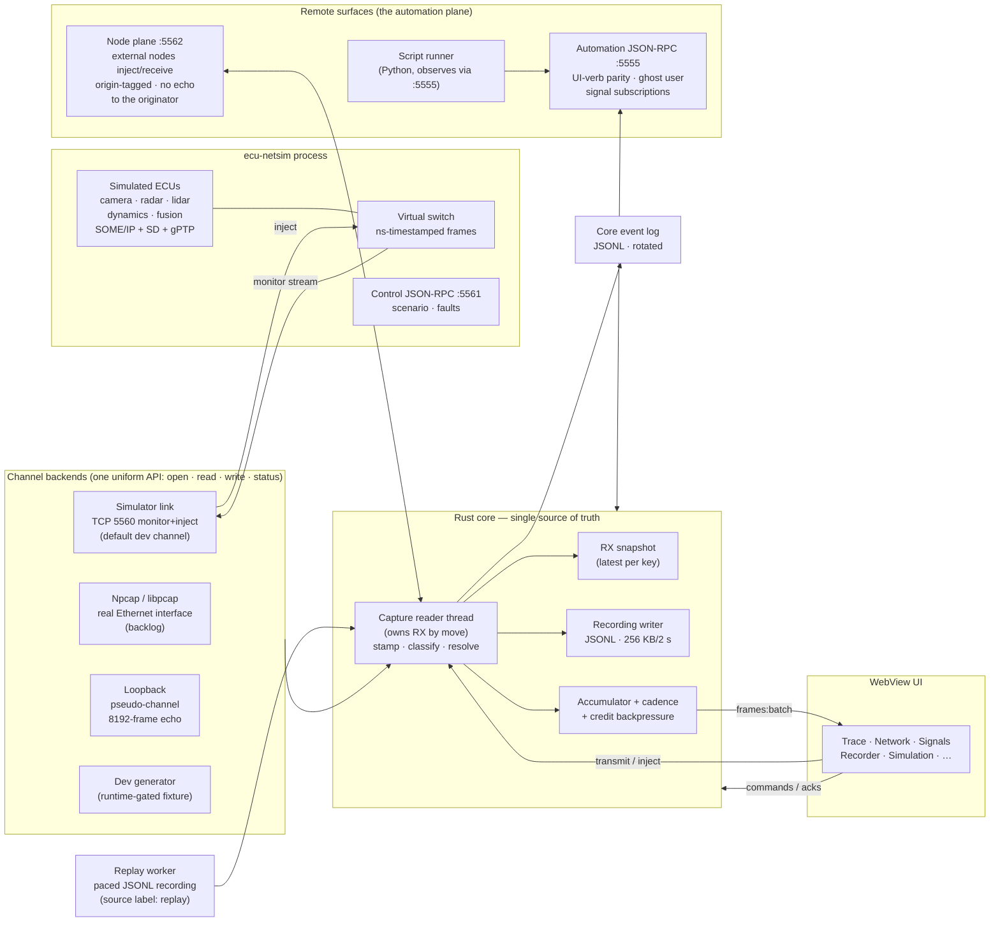
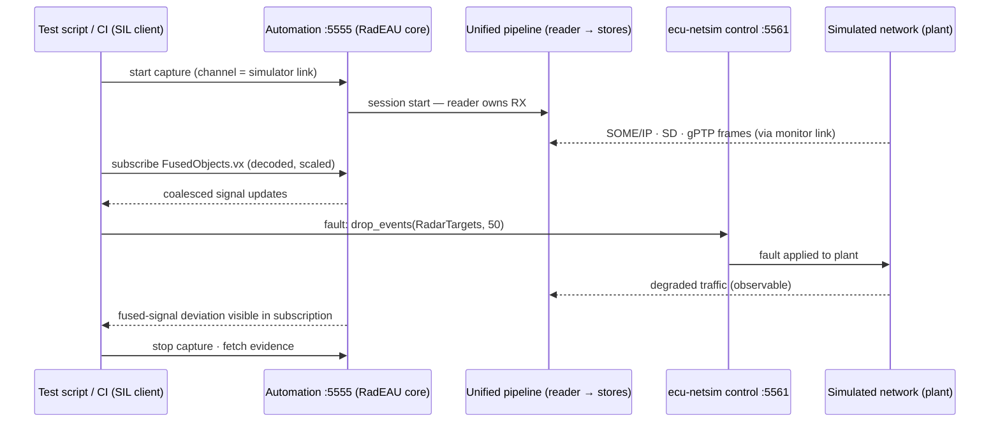

# RadEAU — Architecture Overview (diagrams)

Diagram companion to the normative documents — [PRD.md](../PRD.md) §3–§4,
[SRS_streaming.md](SRS_streaming.md), [SRS_protocols.md](SRS_protocols.md),
[SRS_ecu_netsim.md](SRS_ecu_netsim.md). Where this page and those documents
disagree, the documents win.

## 1. Current data path (v0.1.x — as built)

One pipeline slice exists end to end today. Its **source is the dev frame
generator (PRD §3.8), wired directly into the capture module** — a deliberate
temporary shortcut: the channel abstraction it will move behind arrives in
v0.3.1. Everything downstream of the accumulator is already the real,
spec-shaped pipeline (PF-001..004 implemented and tested).

In a plain browser (no Tauri), a TypeScript mirror of the generator
(`devGenMirror.ts`) emits the identical `frames:batch` shape on the identical
cadence, so every view behaves the same in browser-mode development and E2E.

## 2. Target unified pipeline (specified; lands v0.3 → v0.4)

**One channel abstraction, one reader, one source of truth** (PRD §3.2, §3.5).
Every frame source — a real Ethernet interface, the simulator, the in-process
loopback, the dev generator — is a backend behind the same compile-time channel
API. Exactly one **capture reader thread** owns the RX side by move; it is the
single place where frames are timestamped, classified, recorded, and batched.
Nothing downstream knows or cares which backend produced a frame.

Key consequences:

- **Source transparency.** Switching from `ecu-netsim` to a real NIC (or
  replaying a recording) changes which backend the reader polls — nothing else.
  Views, recording, automation clients, and tests see identical behavior.
- **The reader is the only writer** of the RX snapshot, the recording, and the
  emit accumulator. There is no second path for frames into the system;
  injected/transmitted frames enter through the channel `write` and come back
  as observed traffic like everything else.
- **Four frame-source classes, one pipeline**: channel RX (simulator or a real
  NIC), replay files, the UI's Simulation view, and external nodes on the node
  plane (:5562). Every frame carries a source label + originating node id
  (PRD §3.4) shown in Trace; fan-out reaches every sink **except the frame's
  originator** — Node A never receives what Node A sent (PRD §8.3).
- **Replay** substitutes the reader's source with the paced recording worker but
  reuses the same batched/backpressured emit path (`replay` source label).
- **Everything on disk is JSONL** — frame recordings and the core event log
  alike; the hot-path IPC batch is deliberately not JSON-encoded per frame
  (decision D5).

## 3. Automation and SIL layering (v0.6–v0.7 surfaces)

The SIL story is the **ghost-user principle** (PRD §1.1-4): a script drives the
same verbs the operator drives, against the same core, over the same unified
pipeline — plus fault control over the simulated plant.

Both surfaces enforce the same posture: loopback bind by default; external bind
requires token + allowlist or startup rejection (PRD §8.1).

## 4. Where the pieces land in the plan

| Piece | Iteration |
|---|---|
| Channel abstraction + loopback + stub backends | v0.3.1 |
| Protocol codecs shared by app and simulator (`radeau-proto`) | v0.3.0 (crate exists; framing layer landed) |
| `ecu-netsim` virtual switch + monitor/inject link + simulator-link backend | v0.4.0 |
| SOME/IP + SD runtimes, gPTP, fusion scenario, fault verbs | v0.4.1–v0.4.2 |
| Live decode + Trace/Network/Signals on real traffic | v0.5 |
| Transmission + automation surface (:5555), script runner | v0.7 |
